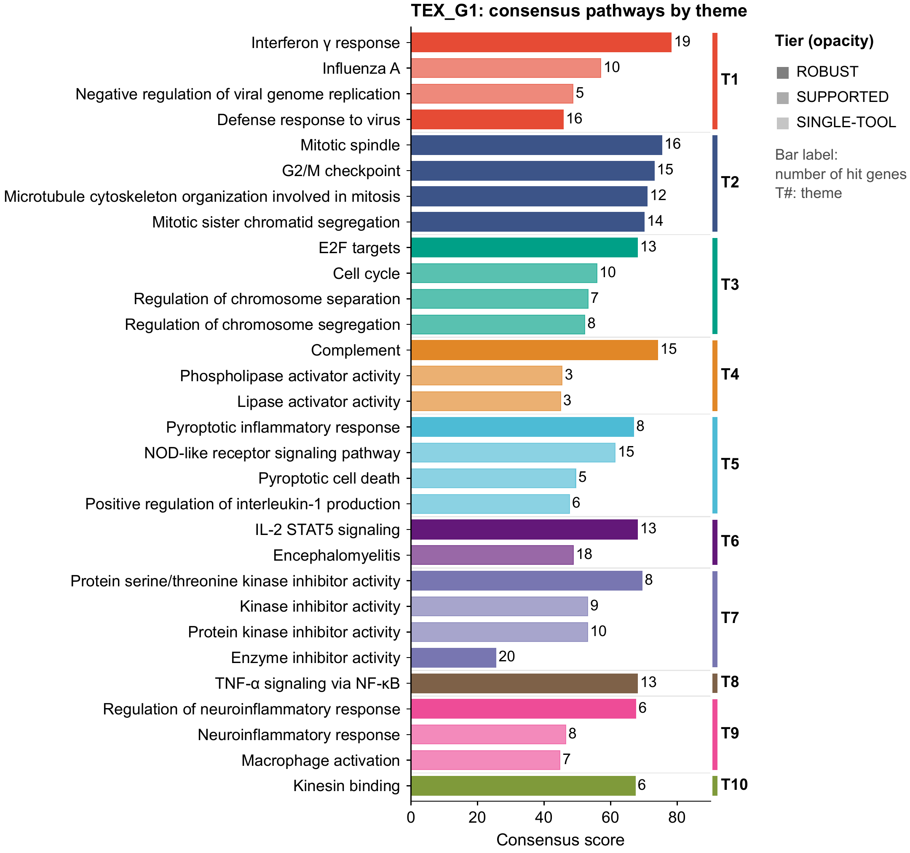
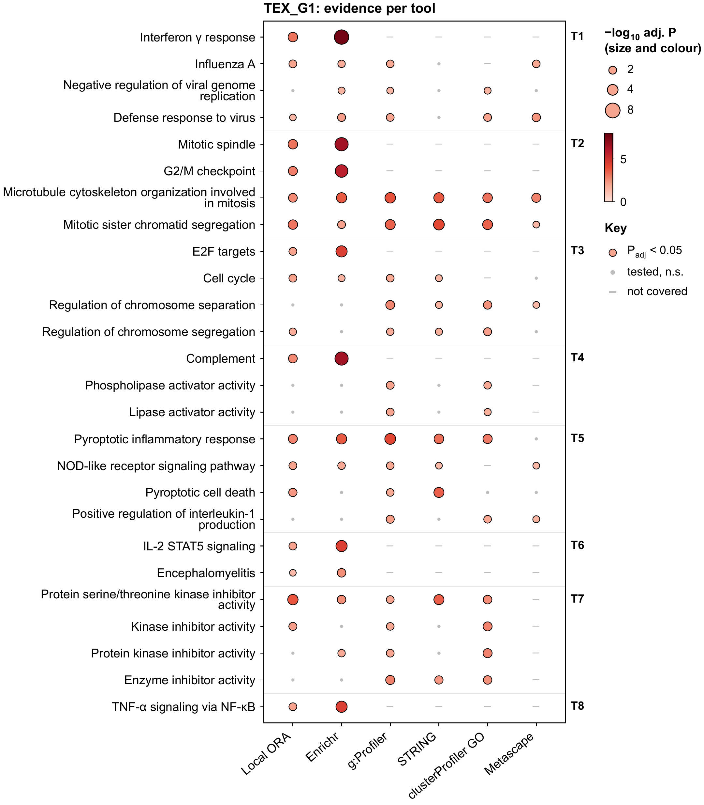
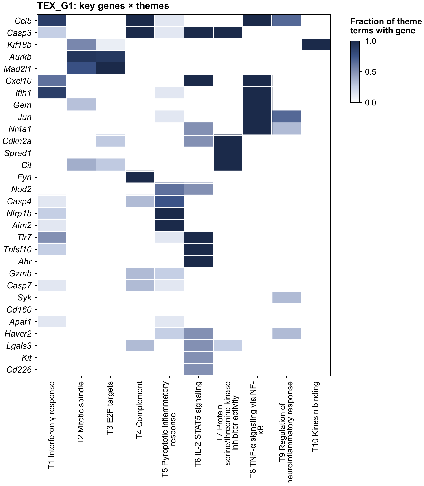
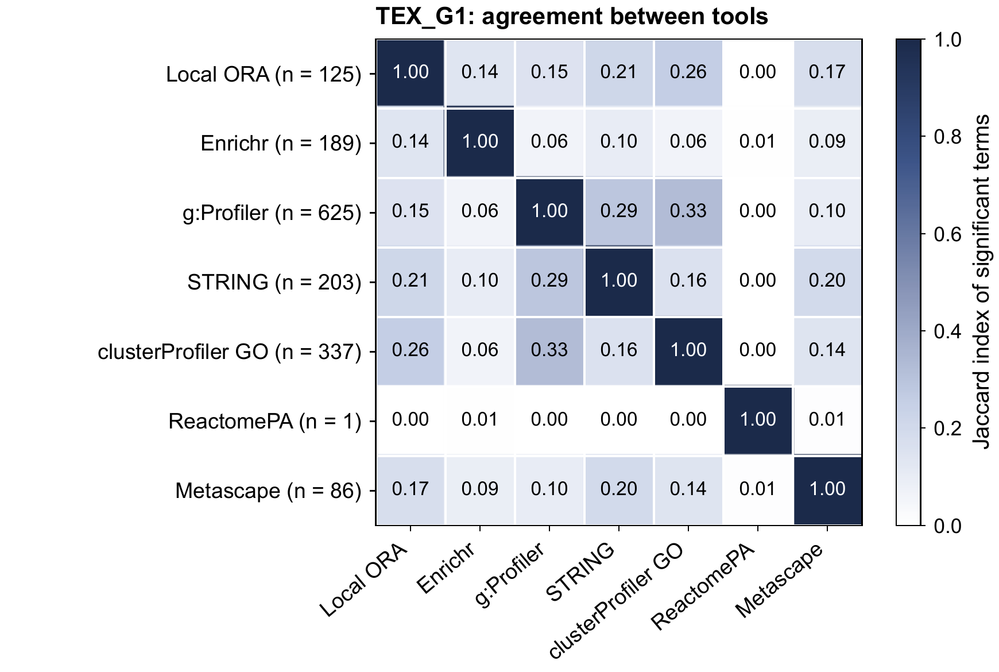

# PathwayAgent

Fast pathway analysis that runs several enrichment tools at once and combines them into a cross-tool
consensus: robust themes, key genes, and figures ready for publication.
A worked example on real data (three CD8 T cell gene modules, with Metascape) is in `TUTORIAL.md`.

## What it produces

Every gene list gets a consensus table, themes, key genes and nine publication-ready figures. The two
below come from the tutorial run (module `TEX_G1` of exhausted CD8 T cells, eight tools plus Metascape).



*Figure 01. Top consensus terms, grouped into themes (T1–T10). Bar length is the 0–100 consensus score,
opacity is the evidence tier, and the label is the number of hit genes.*



*Figure 03. The same terms, one column per tool. Bubble size and colour give −log10 adjusted P; a grey dot
means tested but not significant; a dash means the tool does not cover that database. Complement and
interferon γ response are Hallmark sets, so only Local ORA and Enrichr can see them.*

| Key genes × themes | Agreement between tools |
|---|---|
|  |  |

*Figures 06 and 07. Left: which genes carry which theme (Casp3 spans interferon, complement and IL-2/STAT5;
Aurkb and Mad2l1 drive the mitotic themes). Right: Jaccard overlap of each tool's significant terms. No
pair exceeds about 0.33, which is why a cross-tool consensus is needed at all.*

More figures, with explanations, are in `TUTORIAL.md`. The images are 300-dpi renders; the vector PDF of
each sits beside it in `docs/figures/`.

PathwayAgent is alpha-stage research software. The core package is usable, tested offline, and documented,
but the public repository should keep generated libraries, result folders, and local virtual environments
out of Git.

## Python API and small example

See [the Python API reference](docs/PYTHON_API.md) for request parameters, return values,
progress callbacks, and failure handling. A [small interferon example](docs/WORKED_EXAMPLE.md)
is included in both the wheel and source distribution:

```bash
python -m pathwayagent.examples.interferon --out results/interferon
```

Build the mouse database first using the setup below. The example runs locally without R or web services.
Download versioned packages from [GitHub Releases](https://github.com/helenhuangmath/PathwayAgent/releases).

## Setup (one time)

```bash
python -m venv .venv
.venv/bin/pip install -e ".[dev]" scikit-learn
.venv/bin/python -m pathwayagent db build        # gene-set library, term maps, R GO cache (~5 min)
```

R tools use `/usr/local/bin/Rscript` (arm64 R 4.3 with clusterProfiler, fgsea, ReactomePA, org.Mm/Hs.eg.db).
To use a different R, set `PATHWAYAGENT_RSCRIPT`.

Generated state stays out of the source tree. If a `large_data/` folder exists beside the repository folder,
the library and results are written there (`large_data/library/`, `large_data/results/`); otherwise they go to
`library/` and `results/` inside the repository, which Git ignores. Environment variables override both:

```bash
export PATHWAYAGENT_DATA=/path/to/large_data
export PATHWAYAGENT_LIBRARY=/path/to/pathwayagent-library
export PATHWAYAGENT_RESULTS=/path/to/pathwayagent-results
export MPLCONFIGDIR=/tmp/pathwayagent-matplotlib
```

See `docs/INSTALL.md` for a reproducible install checklist.

## Run

```bash
# command line: one or more files; multi-column files are split into one list per column
.venv/bin/python -m pathwayagent run testing/gene_lists/genels_ex_module123.txt --out results/modules
.venv/bin/python -m pathwayagent run de_table.csv --universe expressed_genes.txt --preset everything
.venv/bin/python -m pathwayagent run genes.txt --local-only          # nothing is sent to web services
.venv/bin/python -m pathwayagent run lists.csv --lists TEX_G1 TEX_G2   # only some columns of a multi-column file
.venv/bin/python -m pathwayagent run lists.csv --metascape metascape_all.zip   # add a Metascape result as a tool
.venv/bin/python -m pathwayagent tools                               # list tools and presets

# local web app (http://127.0.0.1:8765) and REST API
.venv/bin/python -m pathwayagent serve      # the page has an "Or load test data" menu with bundled example lists

# REST API example
curl -X POST localhost:8765/api/v1/jobs -H 'Content-Type: application/json' \
     -d '{"text":"Fos\nJun\nEgr1\nNr4a1","preset":"standard"}'
curl localhost:8765/api/v1/jobs/<job_id>

```

Input format is detected automatically:
- one gene per line: gene list (ORA);
- gene + score: ranked list;
- DE table (gene, log2FoldChange, pvalue): ranked by signed −log10 p;
- several columns under a header row: one list per column. The header row is recognised by a header word
  (gene, module, cluster, list, set, up, down) or by column names built on a shared stem (`TEX_G1`, `TEX_G2`).

A GSEA-type test needs a genome-wide ranking (≥1000 genes). For shorter ranked lists, such as a module
with its Wald statistics, the ordered test (mHG) is used instead.

## Tools

| family | tools |
|---|---|
| Over-representation (Fisher / hypergeometric) | `local_ora`, `enrichr`, `gprofiler`, `reactome`, `string`, `clusterprofiler` (same gene sets as the local engine), `clusterprofiler_go` (org.db GO), `reactomepa`, `metascape` (imported result or MSBio) |
| Pre-ranked GSEA | `local_gsea` (blitzGSEA), `fgsea` |
| Rank tests | `local_mhg`, `gprofiler_ordered`, `local_rank` (Wilcoxon) |

Presets:
- `quick`: local engine only, a few seconds;
- `standard`: local + Enrichr, g:Profiler, Reactome, STRING, clusterProfiler, fgsea;
- `everything`: all of the above, plus `metascape` when a result is available.

Metascape has no public API. Analyse the lists at metascape.org, download "All in One Zip File" and pass
it with `--metascape PATH` (zip or unpacked folder; `LIST=PATH` for one package per list; a multi-list
package serves every list it contains by name). Without a package the tool is skipped, unless
`PATHWAYAGENT_MSBIO` points at an MSBio installation whose Docker container is running (this path has
not been tested). Only the ontologies present in the package count as covered by Metascape.

Not yet implemented (they are listed in the tool output): WebGestalt (R package not installed), DAVID
(needs registration), GREAT (needs BED input).

## Outputs (`results/<run>/`)

- `report.html`: interactive report with one tab per list, sortable tables, a network you can hover, and a link to the PDF of every figure.
- `summary.txt` · `methods.txt` (a methods paragraph with versions and citations) · `manifest.json` (parameters, versions, timings).
- `<list>/consensus_terms.tsv`, `themes.tsv`, `key_genes.tsv`, `results.xlsx`, `tools/<tool>.tsv`, `theme_network.cyjs` (opens in Cytoscape).
- `<list>/figures/*.pdf` (vector, Arial 9–10 pt, NPG colours) plus a `.png` preview of each (examples in `docs/figures/`):
  - `01` consensus terms grouped by theme
  - `02` enrichment map of themes
  - `03` term × tool evidence bubbles
  - `04` theme × tool squares
  - `05` key-gene bubbles
  - `06` clustered gene × theme heatmap
  - `07` tool agreement
  - `08` term landscape (each map cluster keeps its number, colour and marker in every run)
  - `09` Metascape clusters against consensus themes (when `metascape` ran)
  - `tools/` dot plot and enrichment map for each tool

## Consensus in one paragraph

Terms are matched across tools by ID (GO, KEGG, Reactome, WikiPathways) or by normalised name. A tool
counts only for terms in databases it covers. The score (0–100) combines four parts, balanced across
method families: median significance (40%), fraction of eligible tools reporting the term as
significant (30%), effect-size percentile (15%) and direction consistency (15%). It is then penalised
for very large or very general terms. A term needs support from ≥2 tools to reach tier SUPPORTED, and
from ≥2 method families (when more than one ran) to reach ROBUST. clusterProfiler in shared-library
mode reproduces `local_ora` exactly (tested), so it is reported but counted only once. Terms are grouped
into themes by kappa similarity of their hit genes. Key genes are scored by their weighted membership
in ROBUST/SUPPORTED themes, and a gene is flagged as a driver when removing it makes a theme lose
significance.

## Example results

The tutorial run can be reproduced with the command in `TUTORIAL.md`: lists `TEX_G1`, `TEX_G2` and
`TEX_G5G6` of `testing/tcell_modules/Cl113_C1toG6_v1.csv`, preset `everything`, with the Metascape tables in
`testing/metascape_reference/`. Generated results are written under `large_data/results/` (or `results/`)
by default, or under `PATHWAYAGENT_RESULTS` when that environment variable is set. For a mature public repository, large example
outputs should be attached to releases rather than committed to Git.

## Tests

Test code, example inputs, and archived prototypes are grouped under `testing/`.
See [testing/README.md](testing/README.md) for the folder guide; the active Python tests are in `testing/unit/`, `testing/validation/`, and `testing/live/`.

```bash
.venv/bin/python -m pytest -m "not live"      # offline: statistics, consensus, planted signal, null calibration, R agreement
.venv/bin/python -m pytest -m live            # external services, server round trip, all Example files end to end
```

## Repository maintenance

- `library/`, `results/`, `large_data/`, `.venv/`, caches and build products are ignored by Git. During
  development the repository lives in `PathwayAgent/github_repo/` with the large library, results and build
  files in the sibling `PathwayAgent/large_data/`.
- CI runs linting, package build checks and the offline test suite.
- `CONTRIBUTING.md`, `CHANGELOG.md` and `docs/REPOSITORY_HEALTH.md` track the remaining work needed for a
  stable public release.

## Citation

If PathwayAgent contributes to a publication, please cite it (see `CITATION.cff`):

> Huang H. PathwayAgent: fast multi-tool pathway analysis with cross-tool consensus. Version 0.1.0, 2026.

`methods.txt` in every run folder gives a ready-made methods paragraph with the versions and citations of the
underlying tools and databases.

## License and contact

PathwayAgent is released under the MIT License (see `LICENSE`).

Author and maintainer: Hua Huang, University of Pennsylvania.
Contact: helenhuang.math@gmail.com. Please use [GitHub issues](https://github.com/helenhuangmath/PathwayAgent/issues) for bugs and feature requests.
