# PathwayAgent tutorial: three CD8 T cell gene modules

This tutorial runs PathwayAgent on real data and explains how to read what comes out. It uses three gene
modules from exhausted CD8 T cells (TEX) and adds an existing Metascape result as one more tool.

## 1. The input

`testing/tcell_modules/Cl113_C1toG6_v1.csv` has one gene module per column, with the module name in the first row:

```
TEX_G1,TEX_G2,TEX_G3,TEX_G4,TEX_G5G6
Ccl5,Rnf213,Adam19,Plek,Chsy1
Prex1,Arl6ip1,Bcl2,Sh2d2a,Nsmaf
...
```

| List | Genes | Mapped to official symbols |
|---|---|---|
| `TEX_G1` | 308 | 298 |
| `TEX_G2` | 146 | 143 |
| `TEX_G5G6` | 111 | 109 |

The lists are plain gene lists with no scores. That decides which tools can run (step 3).

## 2. Run

```bash
.venv/bin/python -m pathwayagent run testing/tcell_modules/Cl113_C1toG6_v1.csv \
    --lists TEX_G1 TEX_G2 TEX_G5G6 \
    --preset everything \
    --metascape testing/metascape_reference \
    --out ../large_data/results/Cl113_TEX_G1_G2_G5G6 \
    --title "Cl113 TEX modules G1, G2, G5G6 (with Metascape)"
```

- `--lists` picks columns of a multi-column file. Leave it out to analyse every column.
- `--preset everything` asks for every tool. `standard` is a lighter choice; `quick` stays local.
- `--metascape` is optional and is explained in step 6.
- `--universe expressed_genes.txt` was not used here, and it should be for real work (step 7).

The run takes about 150 seconds for the three lists. The slow part is the R tools.

## 3. What ran

| Tool | TEX_G1 | TEX_G2 | TEX_G5G6 |
|---|---|---|---|
| `local_ora` | 125 | 145 | 87 |
| `enrichr` | 189 | 169 | 25 |
| `gprofiler` | 625 | 354 | 363 |
| `string` | 203 | 110 | 68 |
| `clusterprofiler_go` | 337 | 192 | 350 |
| `reactome` | 0 | 48 | 0 |
| `reactomepa` | 1 | 55 | 0 |
| `metascape` | 86 | 110 | 57 |

Numbers are terms with adjusted P < 0.05.

Three things to know when reading this table:

- The rank-based tools (`local_mhg`, `local_rank`, `local_gsea`, `fgsea`, `gprofiler_ordered`) were skipped
  because the lists have no scores. Every tool that contributed is an over-representation test.
- `clusterprofiler` ran too. It repeats `local_ora` on the same gene sets, so it is reported as a
  cross-check and counted once.
- `string` and `metascape` return enriched terms only, so "tested" equals "reported" for them.

## 4. The consensus

Terms are matched across tools and scored 0–100. Each term gets a tier:

- **ROBUST**: significant in at least two tools and in at least 60% of the tools that cover its database,
  with a median adjusted P of 0.01 or lower.
- **SUPPORTED**: significant in at least two tools, with at least 30% support.
- **SINGLE-TOOL**: one tool only.

A term normally also needs two method families to be ROBUST. Here only one family ran, so ROBUST means
agreement between implementations and databases of the same test, not between independent methods.

| | TEX_G1 | TEX_G2 | TEX_G5G6 |
|---|---|---|---|
| ROBUST terms | 40 | 79 | 8 |
| SUPPORTED terms | 364 | 185 | 227 |
| Top themes | Interferon γ response; mitotic spindle; E2F targets; complement; pyroptotic inflammatory response | Mitotic microtubule organization; G2/M checkpoint; PLK1 activity at G2/M; sister chromatid cohesion; interferon α response | IL-2/STAT5 signaling; potassium ion transport; regulation of αβ T cell activation; regulation of heart contraction |
| Top key genes | `Casp3`, `Cxcl10`, `Ccl5`, `Nod2`, `Cdkn2a` | `Plk1`, `Cdk1`, `Pole`, `Ccnb1`, `Rad51c` | `Igf1r`, `Itgav`, `Ifng`, `Ptger2`, `Pdgfb` |

`TEX_G1` mixes an interferon/effector signal with proliferation. `TEX_G2` is a cell-cycle module with an
interferon component. `TEX_G5G6` has one strong hit, IL-2/STAT5 signaling (11 genes), and then a set of
terms that make little sense for T cells; step 7 explains why.

| `TEX_G1` | `TEX_G2` |
|---|---|
| 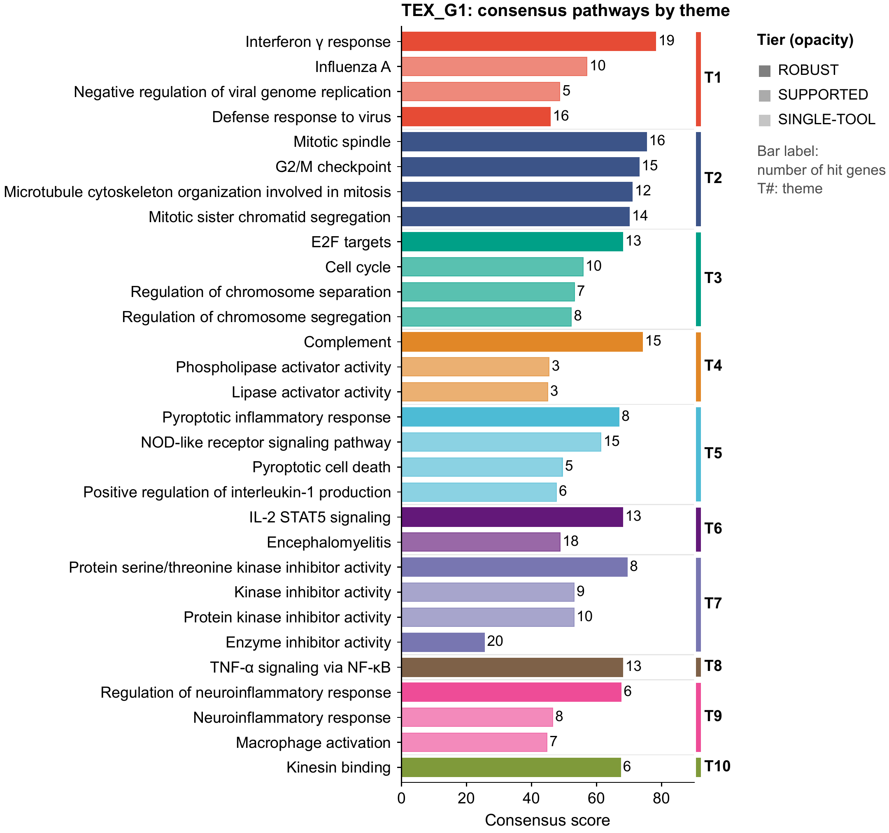 | 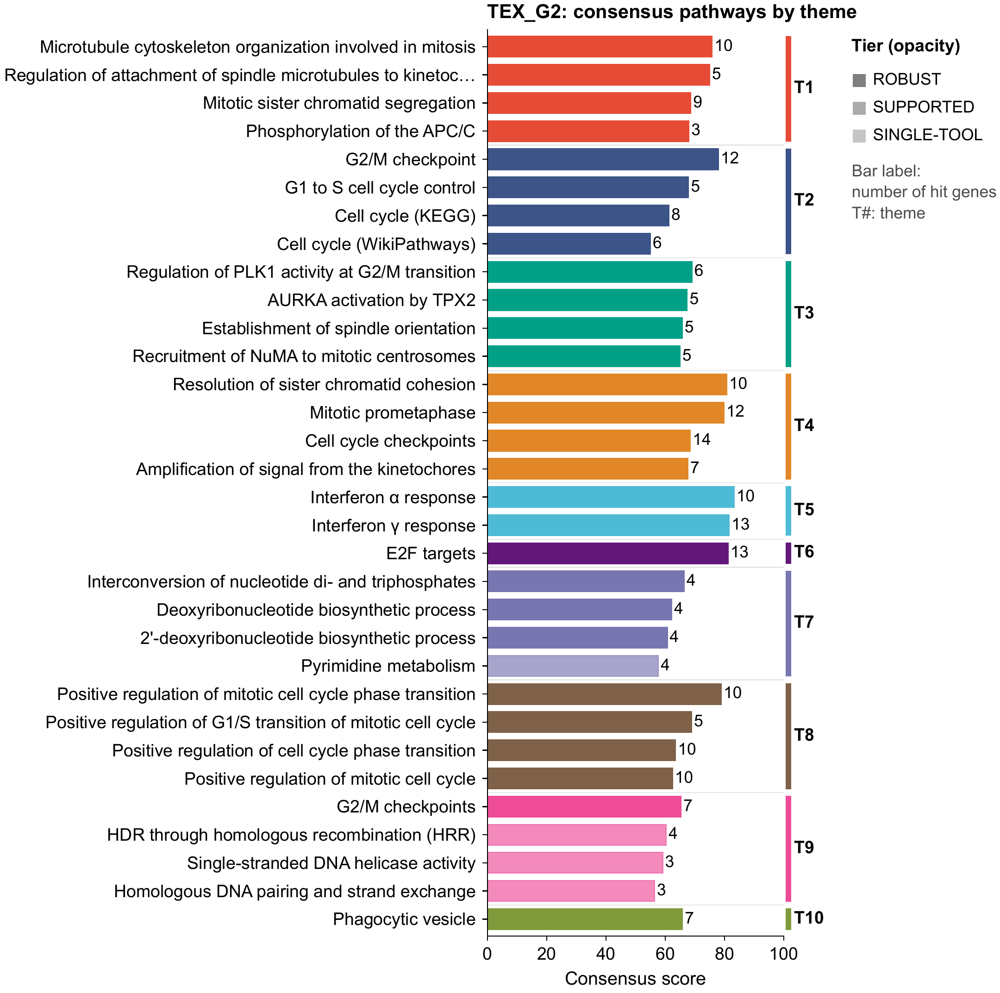 |

*Figure 01 for the two larger lists. Bar length is the consensus score, opacity is the tier, the number is
the hit-gene count, and the coloured bracket is the theme. `TEX_G1` spreads over many themes, from interferon to
mitosis; `TEX_G2` is dominated by mitosis and the cell-cycle checkpoints.*

## 5. Reading the outputs

Open `../large_data/results/Cl113_TEX_G1_G2_G5G6/report.html`. It has one tab per list, sortable tables and a link to the
PDF of every figure. The files behind it are in one folder per list:

| File | Content |
|---|---|
| `consensus_terms.tsv` | every ROBUST, SUPPORTED and SINGLE-TOOL term with its score, support and hit genes |
| `themes.tsv` | terms grouped into themes |
| `key_genes.tsv` | genes ranked by their weight across themes |
| `results.xlsx` | the three tables above plus one sheet per tool |
| `id_mapping.tsv` | what each input gene was mapped to |
| `figures/*.pdf` | vector figures, 7.2 in wide, Arial, 9–10 pt text; a `.png` preview sits next to each. The figures shown in this tutorial are 300-dpi copies in `docs/figures/` |

The figures, in the order you would usually read them:

| Figure | Question it answers |
|---|---|
| `01_consensus_bar` | What are the top terms, and which theme is each in? |
| `03_evidence_bubble` | Which tools support each term? A dash means the tool does not cover that database. |
| `02_theme_network` | How do the terms inside each theme overlap? |
| `04_theme_tool` | How many significant terms does each tool contribute to each theme? |
| `05_key_gene_bubble`, `06_gene_theme_heatmap` | Which genes carry which themes? |
| `07_tool_overlap` | How similar are the tools' significant term sets? |
| `08_landscape_*` | Where do the significant terms sit in the whole database? |
| `09_metascape_clusters` | How do Metascape's own clusters line up with the themes? |

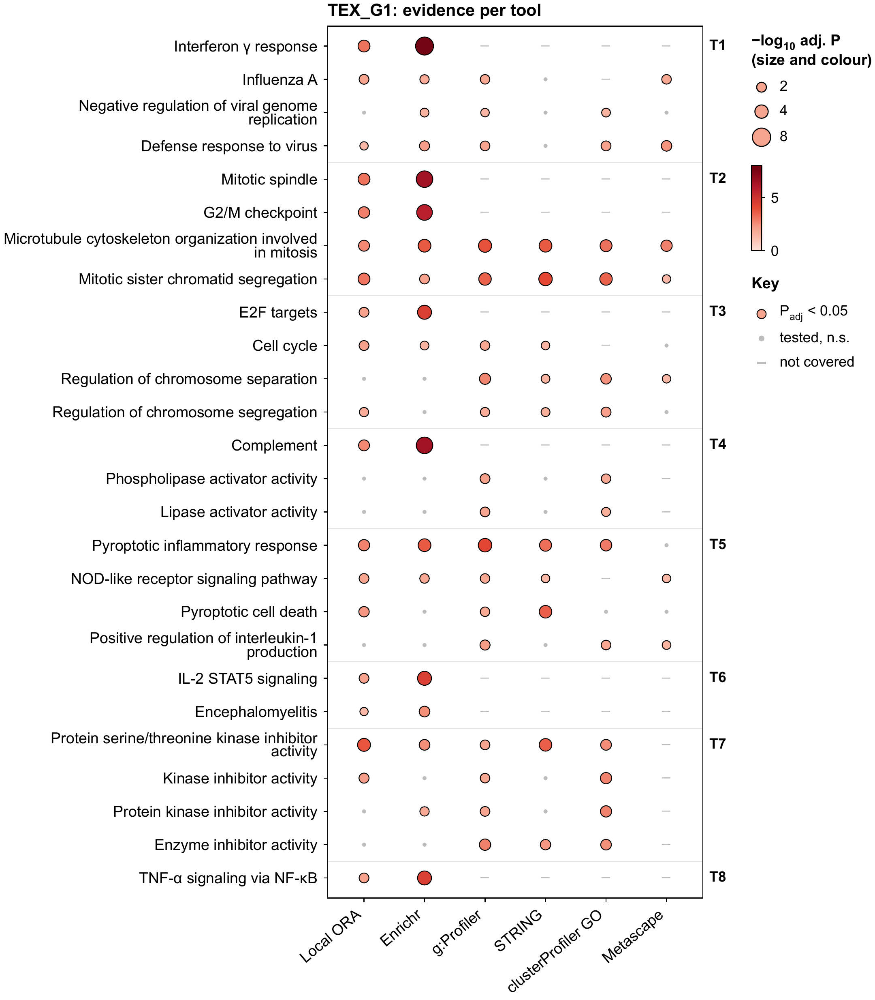

*Figure 03 for `TEX_G1`. Hallmark terms (Complement, Interferon γ response, Mitotic spindle, E2F targets,
IL-2 STAT5 signaling, TNF-α via NF-κB) show a dash for every tool except Local ORA and Enrichr, because the
other tools do not test Hallmark. That is what "a tool counts only for databases it covers" means in
practice. Reactome and ReactomePA found almost nothing for this list, so they have no column here.*

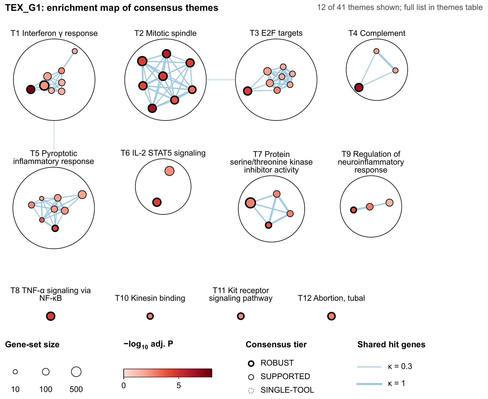

*Figure 02. Enrichment map: each node is a term, edges join terms that share hit genes, colours are the
themes of figure 01. Proliferation (T3, T4) and the inflammatory themes (T1, T5) form separate
neighbourhoods.*

| Theme × tool (04) | Key-gene bubbles (05) |
|---|---|
| 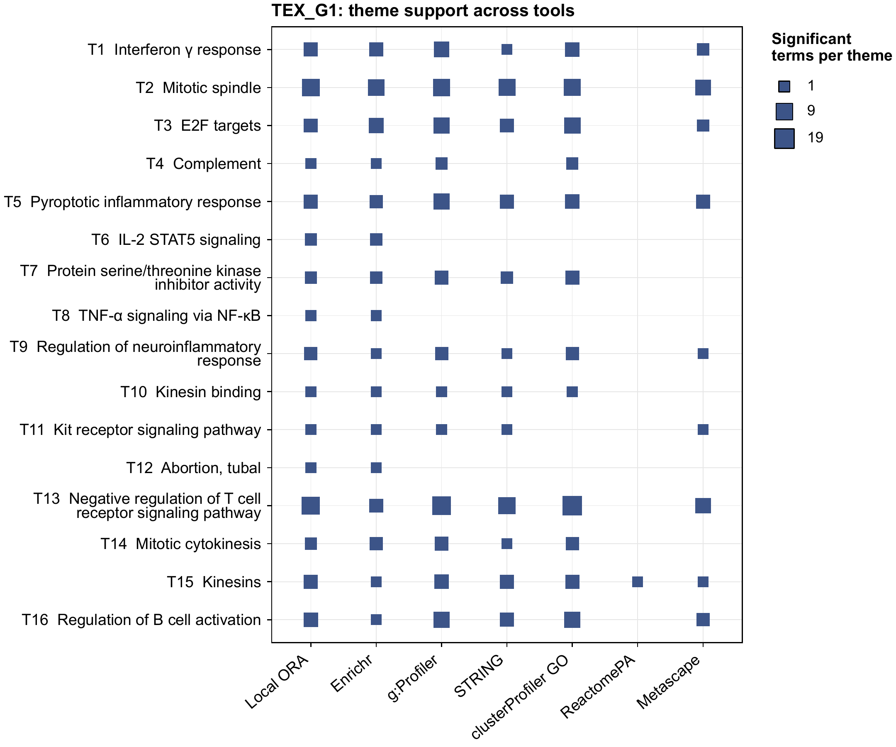 | 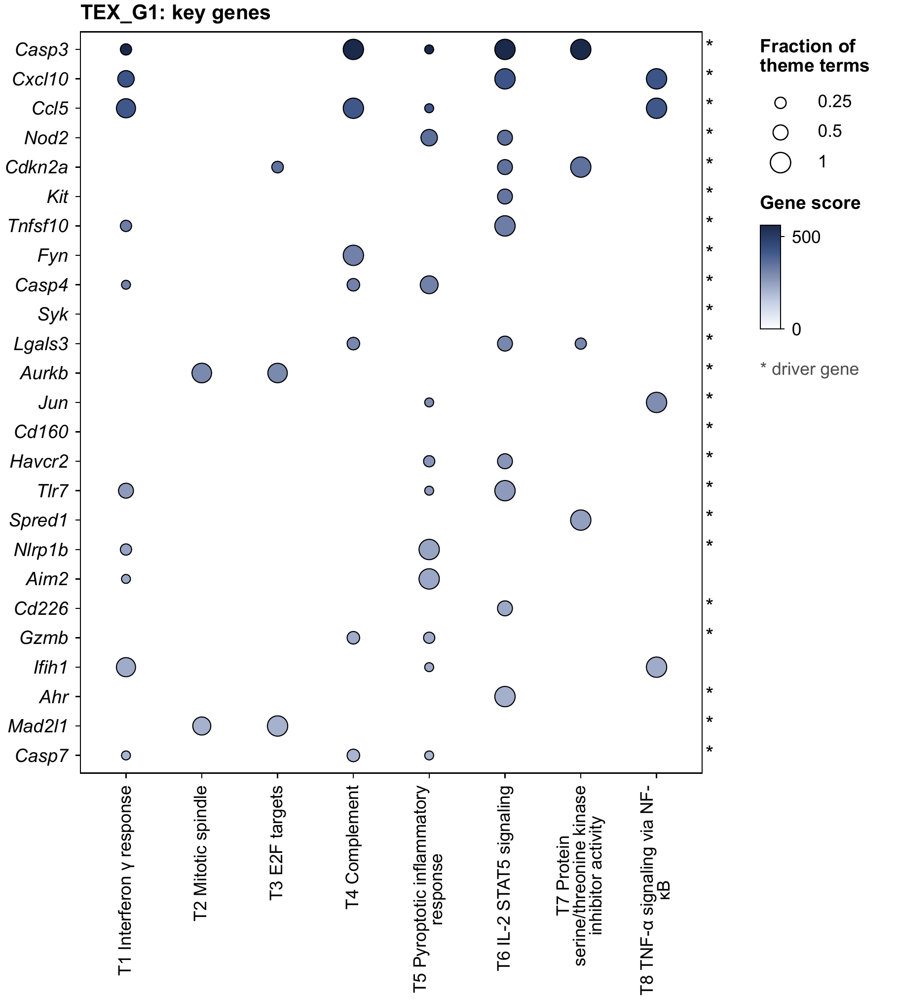 |

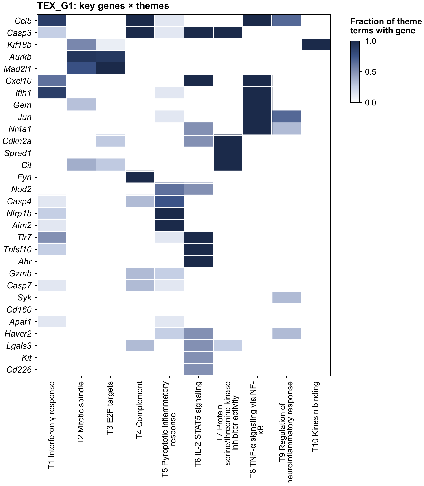

*Figure 06. Rows are key genes ranked by weight, columns are themes, and a cell is the fraction of the
theme's terms that contain the gene. `Casp3` sits in interferon, complement, IL-2/STAT5 and kinase-inhibitor
terms at once, which is why it is the top key gene. `Aurkb` and `Mad2l1` belong only to the mitotic
themes.*

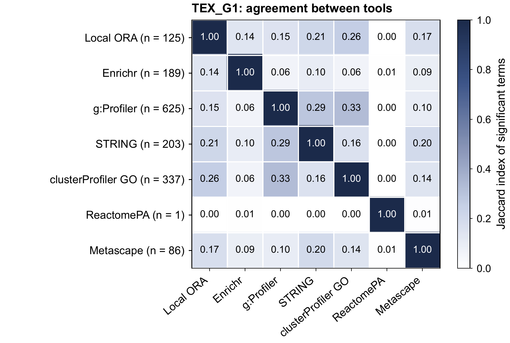

*Figure 07. Jaccard index of the significant term sets. clusterProfiler GO and g:Profiler agree most
(about 0.33) because both test GO; Enrichr agrees least with everyone because it draws on many small
libraries. ReactomePA reported a single term.*

### Themes (T) and map clusters (C) are different things

Both group terms, and they are easy to confuse.

| | Themes `T1, T2 …` | Map clusters `C1, C2 …` |
|---|---|---|
| Figures | 01–06 and 09 | 08 only |
| What is grouped | the significant terms of this run, across all databases | every term of one database |
| Based on | which of your genes each term hit | each term's full gene membership |
| Computed | every run, per gene list | once, when the library is built |
| Numbering | ranked: T1 is the best-scoring theme | arbitrary |
| Same across lists | no | yes |

Because map clusters never change, each one keeps its number, colour and marker in every landscape
figure. C11 is a red square for `TEX_G1`, `TEX_G2` and `TEX_G5G6` alike, so the maps can be put side by
side. The two words after each number are keywords taken from the cluster's term names. They are a hint,
not a curated label.

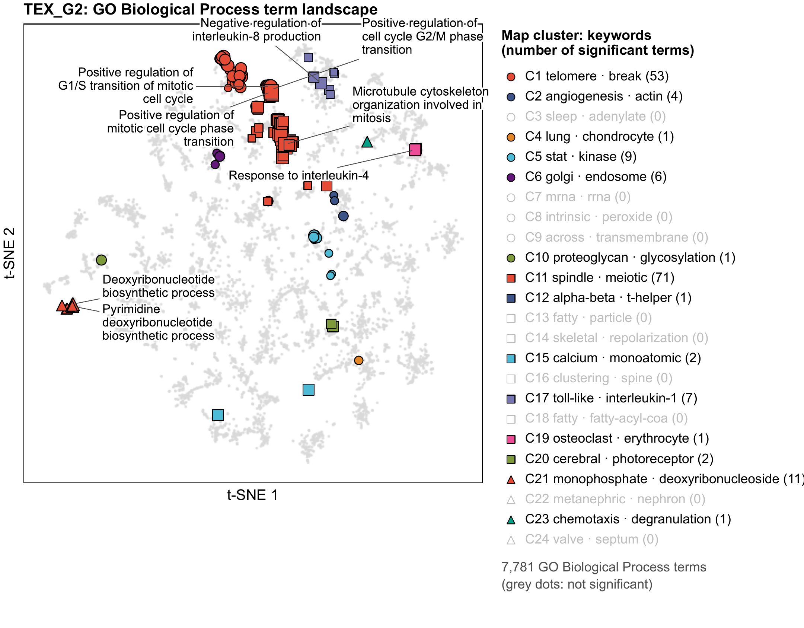

*Figure 08 for `TEX_G2`. Every GO Biological Process term is a point in the map; the significant ones are
highlighted, and the numbered labels are the fixed map clusters described above.*

Themes are re-derived for each list, so T1 of one list is unrelated to T1 of another.

## 6. Adding Metascape

Metascape has no public API. To include it:

1. Analyse the lists at metascape.org.
2. On the report page choose "All in One Zip File".
3. Pass the zip, or the unpacked folder, with `--metascape PATH`.

A multi-list package serves every list it contains, matched by list name. For one package per list use
`--metascape TEX_G1=g1.zip TEX_G2=g2.zip`. Only two files of the package are read:
`Enrichment_GO/GO_AllLists.csv` and `Enrichment_GO/_FINAL_GO.csv`.

The package used here, `testing/metascape_reference/`, holds those two files from a Metascape run of
August 2022. Two limits follow from that:

- It reflects Metascape's 2022 databases.
- It covers GO Biological Process, KEGG, Reactome and WikiPathways. It has no Hallmark sets, so it says
  nothing about the Hallmark hits. PathwayAgent counts Metascape only for the ontologies present in the
  package.

How Metascape compared with the other tools:

| | TEX_G1 | TEX_G2 | TEX_G5G6 |
|---|---|---|---|
| Metascape terms at q < 0.05 | 86 | 110 | 57 |
| Also significant in at least one other tool | 77 (90%) | 103 (94%) | 53 (93%) |
| ROBUST terms, without → with Metascape | 54 → 40 | 85 → 79 | 10 → 8 |

Metascape finds almost nothing the other tools miss, and the top themes stay the same. Adding it makes the
consensus stricter, because a term it does not report loses support.

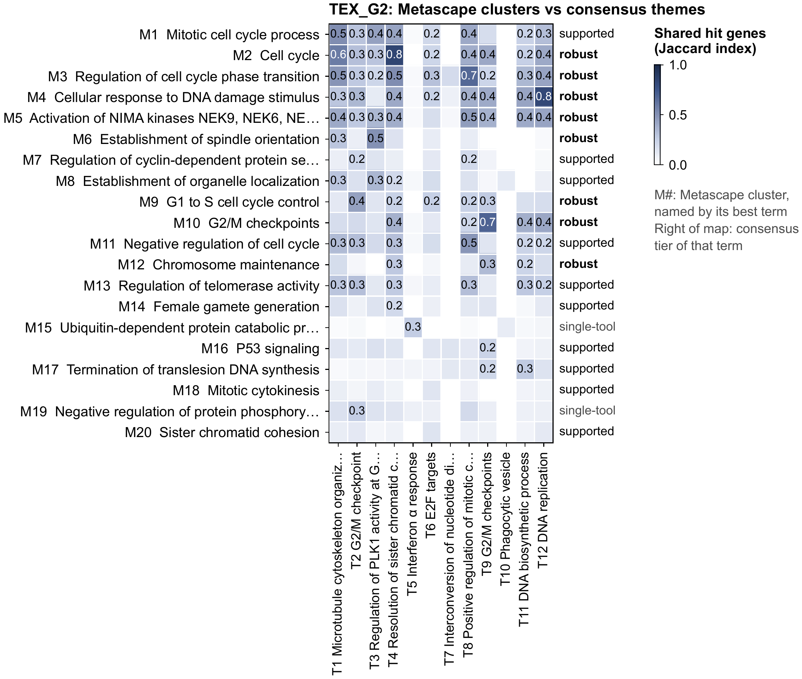

In figure 09 each row is one of Metascape's clusters, named by its best term, and each column is a
consensus theme. A dark cell means the two share most of their hit genes. The word to the right of each
row is the consensus tier of that cluster's best term.

## 7. Caveats of this run

- **No background was supplied.** All 22,921 annotated genes were used. For T cell modules the background
  should be the genes detected in the experiment: add `--universe expressed_genes.txt`. Without it,
  `TEX_G5G6` ranks potassium ion transport, heart contraction and cold-induced thermogenesis highly, each
  on a handful of genes. Metascape reports the same terms, so they come from the gene list and the
  missing background, not from one tool.
- **One method family.** See step 4. Supplying scores (gene + statistic, or a DE table) lets the
  rank-based tools run.
- **Unmapped genes.** `TEX_G1` contains `4-Sep`, a Septin gene that a spreadsheet turned into a date; fix
  it in the CSV. `Mx1` also fails to map. Check `id_mapping.tsv` after every run.
- **Per-tool dot plots show the top 15 terms even when none is significant.** Such plots carry the note
  "No term reaches adj. P < 0.05" (for example Reactome for `TEX_G1`).

Each tool also gets its own dot plot and enrichment map under `figures/tools/`. They show what that tool
alone would have reported, which is useful when the consensus disagrees with a tool you trust.

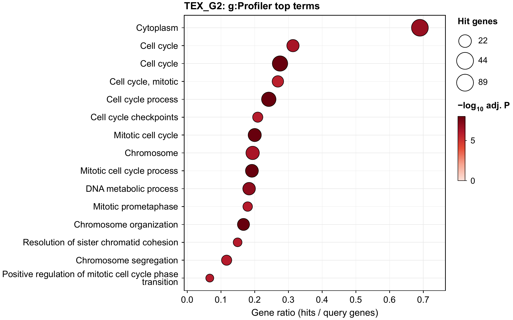

## 8. Variations

```bash
# one list, local tools only, a few seconds
.venv/bin/python -m pathwayagent run testing/tcell_modules/Cl113_C1toG6_v1.csv --lists TEX_G2 --preset quick

# with a background and without sending genes to web services
.venv/bin/python -m pathwayagent run testing/tcell_modules/Cl113_C1toG6_v1.csv --universe expressed_genes.txt --local-only

# the same analysis in the browser
.venv/bin/python -m pathwayagent serve
```
