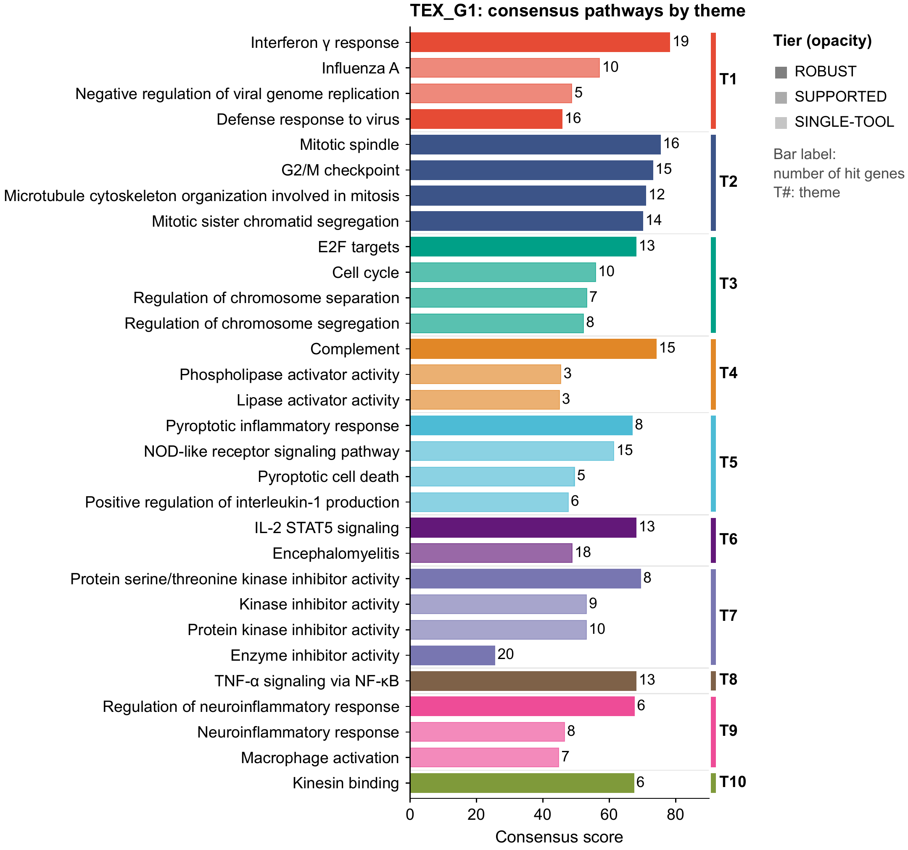
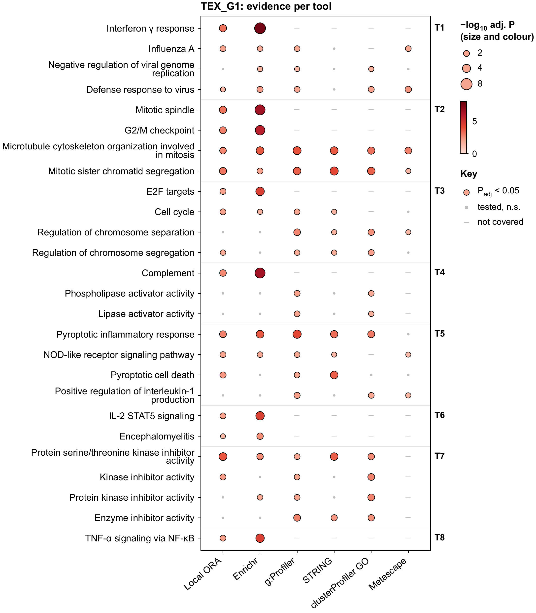
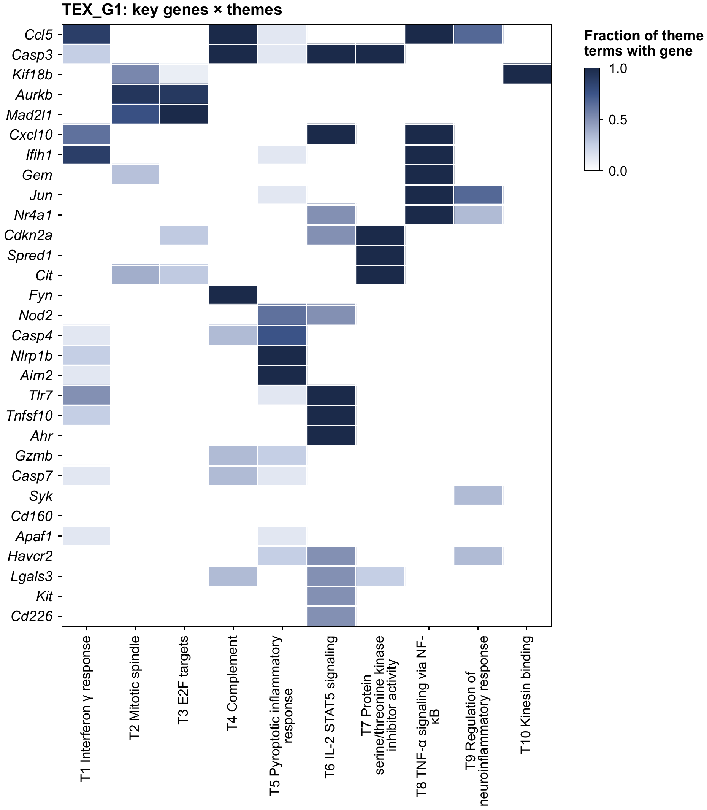
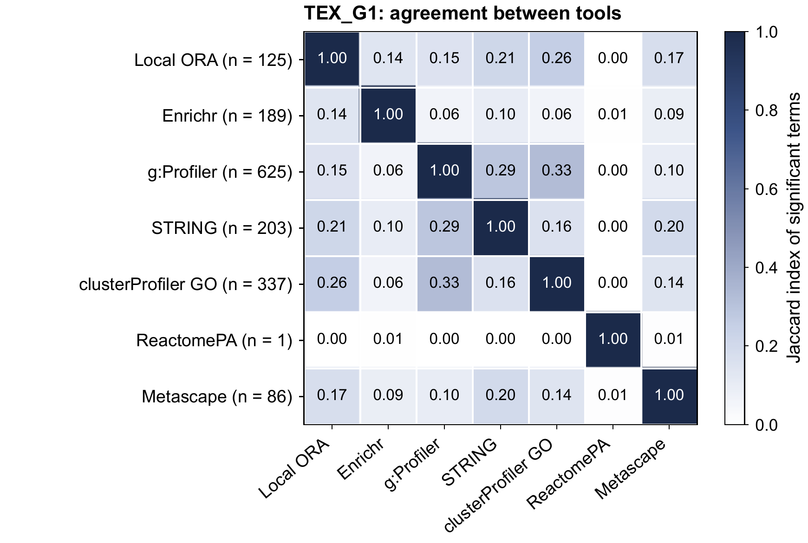

# PathwayAgent

**Fast pathway analysis that runs several enrichment tools at once and combines them into a
cross-tool consensus: robust themes, key genes, and figures ready for publication.**

[Get started](quickstart.md){ .md-button .md-button--primary }
[Tutorial](tutorial.md){ .md-button }
[GitHub](https://github.com/helenhuangmath/PathwayAgent){ .md-button }

## Introduction

Pathway enrichment tools rarely agree. Give the same gene list to Enrichr, g:Profiler, STRING,
clusterProfiler and Metascape and each returns a different list of significant terms: they use
different databases, database versions, backgrounds and statistics. In the tutorial data no pair of
tools shares more than about a third of its significant terms. Reporting the output of one tool
means reporting that tool's choices along with the biology.

PathwayAgent takes a gene list, a ranked list or a differential-expression table, runs up to 14
tools in parallel (local engines, web services and R packages), and then answers one question:
**which pathways are supported no matter which tool you ask?**

1. **Run.** Local over-representation, GSEA and rank tests, plus Enrichr, g:Profiler, Reactome,
   STRING, clusterProfiler, ReactomePA, fgsea and an imported Metascape result.
2. **Match.** Terms are matched across tools by ID (GO, KEGG, Reactome, WikiPathways) or by
   normalised name. A tool counts only for the databases it covers.
3. **Score.** Each term gets a 0–100 consensus score and an evidence tier: ROBUST, SUPPORTED or
   SINGLE-TOOL.
4. **Summarise.** Related terms are grouped into themes, and genes are ranked by how many
   well-supported themes they carry.
5. **Report.** An interactive HTML report, tables, an Excel workbook, a methods paragraph and nine
   vector figures per gene list.

## What it produces

The figures below come from the [tutorial](tutorial.md) run: module `TEX_G1` of exhausted CD8 T
cells, eight tools plus Metascape.

*Top consensus terms, grouped into themes (T1–T10). Bar length is the 0–100 consensus score,
opacity is the evidence tier, and the label is the number of hit genes.*

*The same terms, one column per tool. Bubble size and colour give −log10 adjusted P; a grey dot
means tested but not significant; a dash means the tool does not cover that database.*

| Key genes × themes | Agreement between tools |
|---|---|
|  |  |

*Left: which genes carry which theme. Right: Jaccard overlap of each tool's significant terms. No
pair exceeds about 0.33, which is why a cross-tool consensus is needed.*

## Features

| | |
|---|---|
| **Many tools, one run** | 14 adapters in three method families (over-representation, pre-ranked GSEA, rank tests). See [Tools and presets](tools.md). |
| **Automatic input detection** | Gene lists, ranked lists, DE tables and multi-column module files. See [Inputs and command line](usage.md). |
| **Transparent consensus** | A documented score and tier for every term, balanced across method families. See [How the consensus works](consensus.md). |
| **Publication figures** | Vector PDF, Arial 9–10 pt, with a PNG preview of each. See [Outputs and figures](outputs.md). |
| **Three ways to run** | Command line, [Python API](PYTHON_API.md), and a local [web app with a REST API](webapp.md). |
| **Private when needed** | `--local-only` never sends genes to an external service. |
| **Mouse and human** | `mmusculus` and `hsapiens`, detected automatically from the gene symbols. |

## Where to go next

- [Installation](INSTALL.md): install the package and build the gene-set library.
- [Quick start](quickstart.md): a first analysis in three commands.
- [Tutorial](tutorial.md): a full run on three CD8 T cell modules, and how to read every output.
- [Small worked example](WORKED_EXAMPLE.md): 20 interferon genes, no R and no web services.

## Status

PathwayAgent is research software (current release: v1.0.1). The core package is tested offline and
documented. Some adapters depend on external web services, which can change their behaviour, and the
R-based tools need a local R/Bioconductor installation. Please report problems on
[GitHub issues](https://github.com/helenhuangmath/PathwayAgent/issues).
