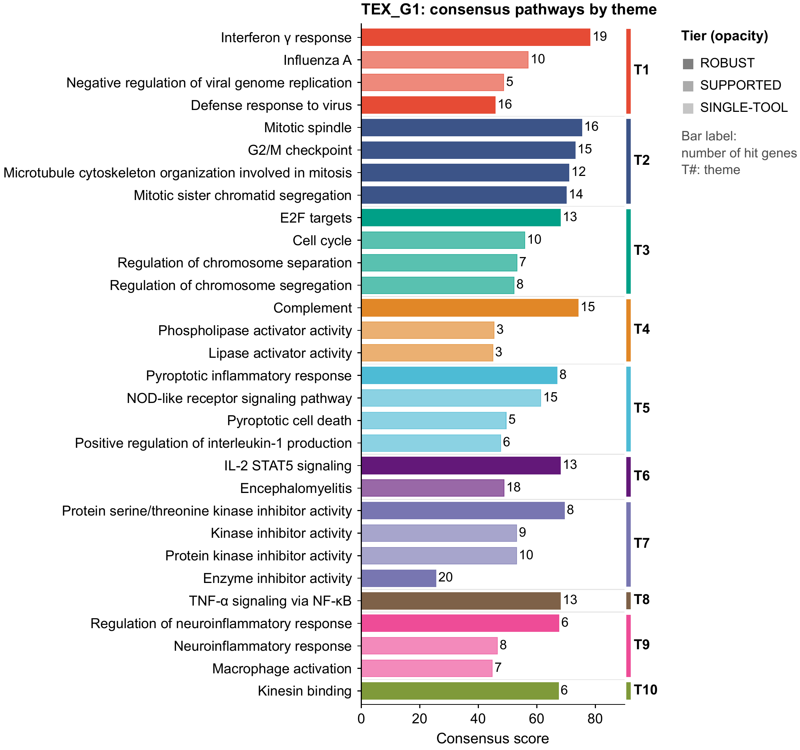
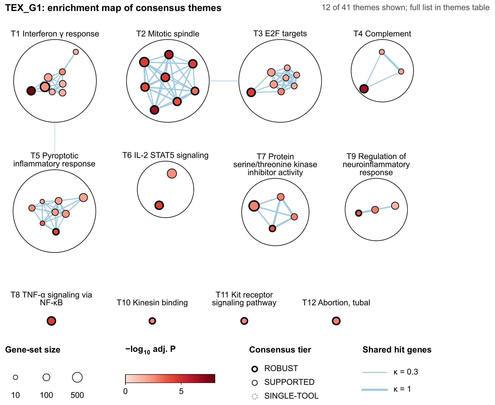
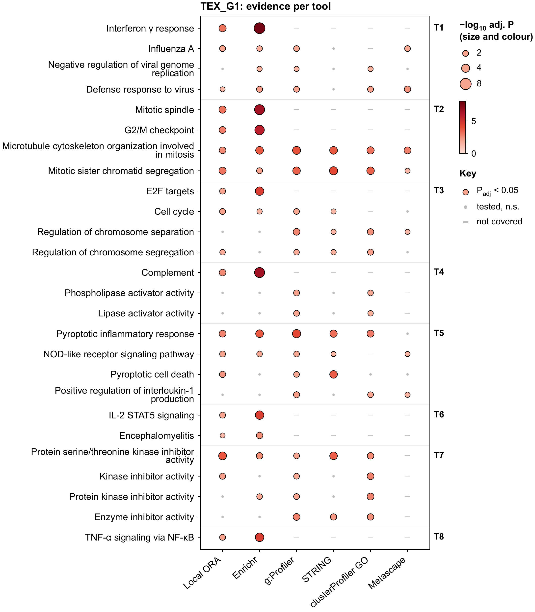
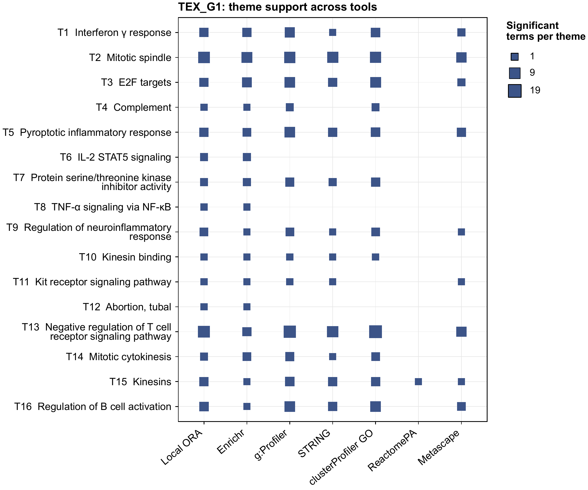
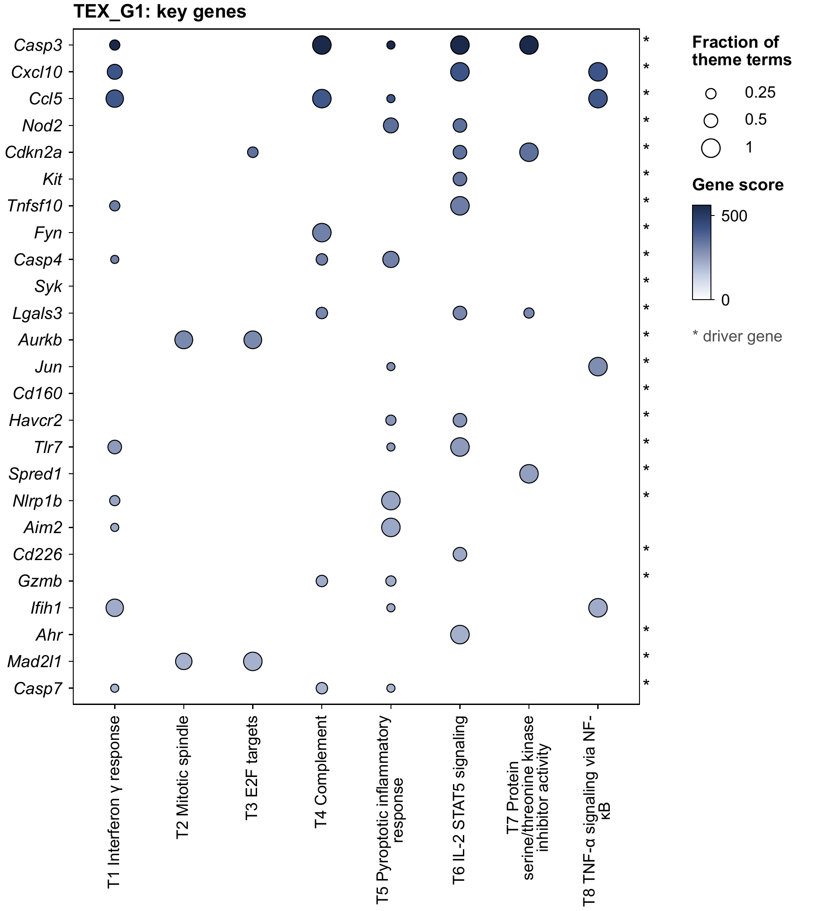
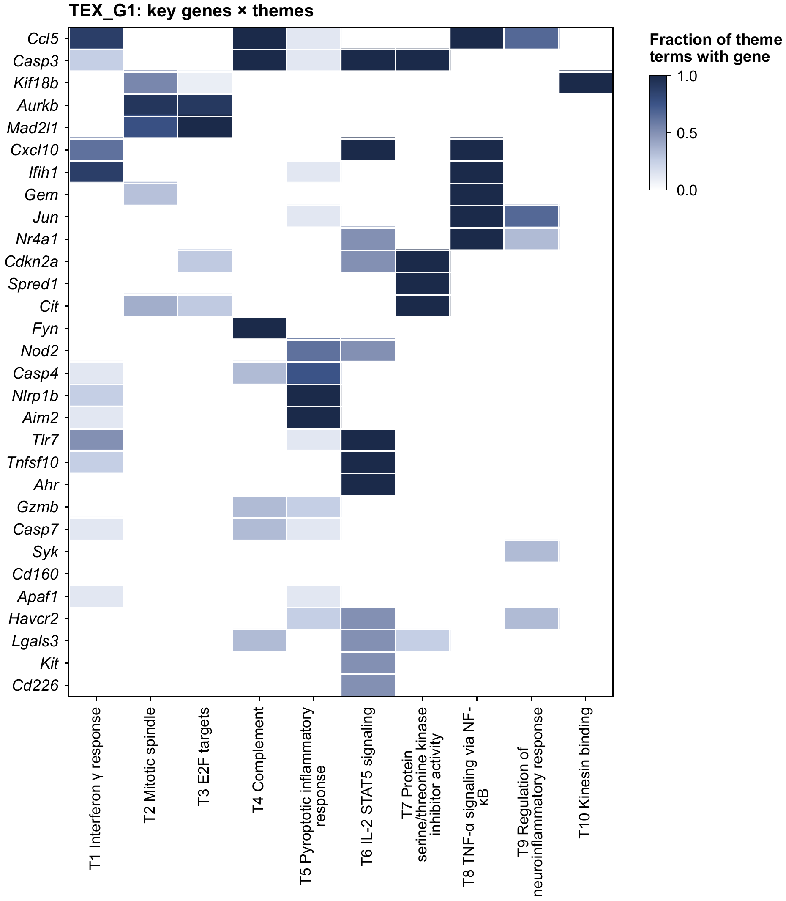
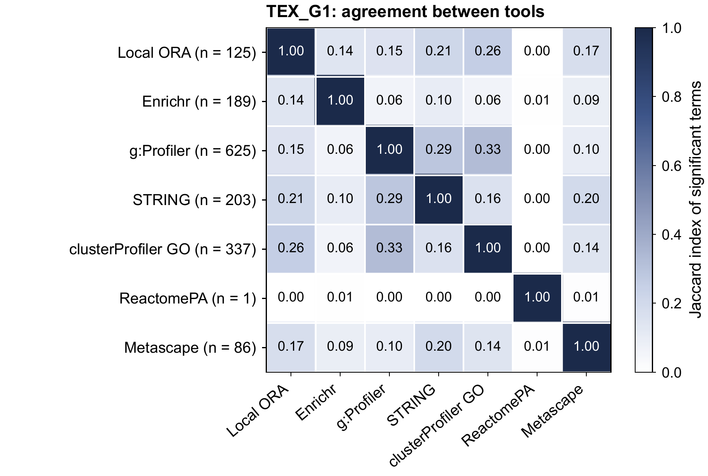
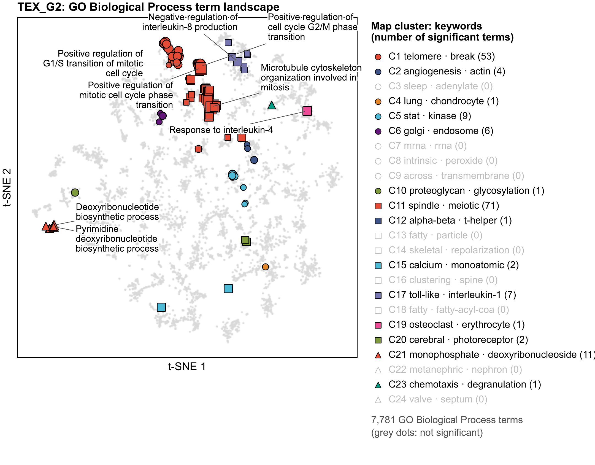
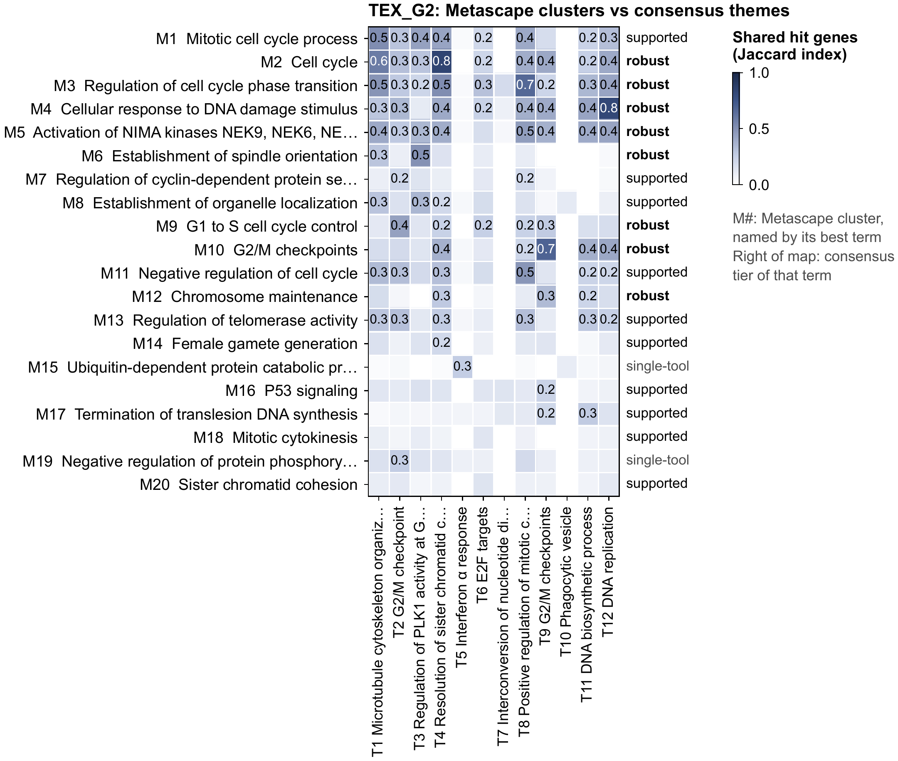
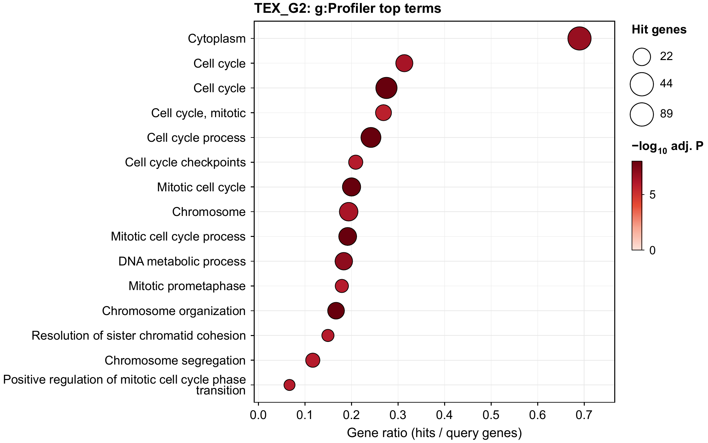

# Outputs and figures

Every run writes one folder. The [tutorial](tutorial.md) walks through a real one.

## Files

```
results/<run>/
├── report.html              interactive report: one tab per list, sortable tables, network, figure links
├── summary.txt              plain-text summary of the run
├── methods.txt              methods paragraph with versions and citations
├── manifest.json            parameters, versions, database information, timings
└── <list>/
    ├── consensus_terms.tsv  every ROBUST, SUPPORTED and SINGLE-TOOL term: score, support, hit genes
    ├── themes.tsv           terms grouped into themes
    ├── key_genes.tsv        genes ranked by their weight across themes
    ├── results.xlsx         the three tables above plus one sheet per tool
    ├── id_mapping.tsv       what each input gene was mapped to
    ├── theme_network.cyjs   theme network; opens in Cytoscape
    ├── tools/<tool>.tsv     harmonised results of each tool
    └── figures/             vector PDFs with a PNG preview of each
```

!!! note "After every run"
    Read `id_mapping.tsv` (spreadsheets turn gene names such as `Sept4` into dates) and the tool
    status in the report. A completed run can have partial tool evidence.

## Figures

Figures are vector PDF, 7.2 in wide, Arial 9–10 pt, NPG colours. In the order you would usually read
them:

| Figure | Question it answers |
|---|---|
| `01_consensus_bar` | What are the top terms, and which theme is each in? |
| `03_evidence_bubble` | Which tools support each term? |
| `02_theme_network` | How do the terms inside each theme overlap? |
| `04_theme_tool` | How many significant terms does each tool contribute to each theme? |
| `05_key_gene_bubble`, `06_gene_theme_heatmap` | Which genes carry which themes? |
| `07_tool_overlap` | How similar are the tools' significant term sets? |
| `08_landscape_*` | Where do the significant terms sit in the whole database? |
| `09_metascape_clusters` | How do Metascape's clusters line up with the themes? (only when `metascape` ran) |
| `tools/` | A dot plot and an enrichment map for each tool on its own. |

### 01 Consensus terms by theme



Bar length is the consensus score, opacity is the tier, the number is the hit-gene count, and the
coloured bracket is the theme.

### 02 Theme network



Each node is a term, edges join terms that share hit genes, and colours are the themes of figure 01.

### 03 Evidence per tool



Bubble size and colour give −log10 adjusted P. A grey dot means tested but not significant. A dash
means the tool does not cover that database.

### 04 and 05 Theme × tool, key genes

| Theme × tool (04) | Key-gene bubbles (05) |
|---|---|
|  |  |

### 06 Key genes × themes



Rows are key genes ranked by weight, columns are themes, and a cell is the fraction of the theme's
terms that contain the gene.

### 07 Agreement between tools



Jaccard index of the tools' significant term sets.

### 08 Term landscape



Every term of one database is a point; the significant ones are highlighted. The numbered map
clusters are computed once, when the library is built, so each keeps its number, colour and marker
in every run and maps of different lists can be compared side by side.

### 09 Metascape clusters against themes



Each row is one of Metascape's clusters, each column a consensus theme. A dark cell means the two
share most of their hit genes.

### Per-tool plots



These show what one tool alone would have reported, which is useful when the consensus disagrees
with a tool you trust. A per-tool dot plot shows the top 15 terms even when none is significant; in
that case it carries the note "No term reaches adj. P < 0.05".

## Themes and map clusters are different things

| | Themes `T1, T2 …` | Map clusters `C1, C2 …` |
|---|---|---|
| Figures | 01–06 and 09 | 08 only |
| What is grouped | the significant terms of this run, across all databases | every term of one database |
| Based on | which of your genes each term hit | each term's full gene membership |
| Computed | every run, per gene list | once, when the library is built |
| Numbering | ranked: T1 is the best-scoring theme | arbitrary |
| Same across lists | no | yes |
